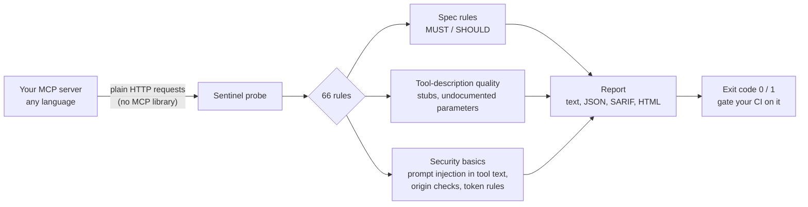

# Sentinel

**Sentinel checks whether an MCP server follows the MCP specification.**

[MCP](https://modelcontextprotocol.io) (Model Context Protocol) is how AI apps such as Claude
connect to tools. A tool is exposed by an *MCP server*, and the server has to follow a rulebook, the
MCP specification. Servers often get parts of it wrong, and then they break or misbehave with some
clients. Sentinel finds those mistakes.

You give it a server's URL. It sends the server test requests, checks each answer against the
rulebook, and prints a pass/fail list. Every failure says what it saw, what to change, and which
page of the spec the rule comes from.

## Try it in 30 seconds

No clone, no setup, nothing to configure. This starts two practice servers on your machine (one
with deliberate mistakes, one correct), scans both, and shows you the difference:

```bash
uvx --from "git+https://github.com/patsypppe/sentinel@main#subdirectory=harness" sentinel demo
```

```
=== Server A: has deliberate mistakes ===
  required rules (MUST):  4 pass, 33 fail, 7 could not be checked from outside
  FAIL  MUST/cacheable-results-carry-ttl
        4 of 4 list results omit ttlMs: ['server/discover', 'tools/list', ...]
  ... and 29 more
  verdict: FAIL (exit code 1)

=== Server B: follows the rules ===
  required rules (MUST):  36 pass, 0 fail, 6 could not be checked from outside
  verdict: PASS (exit code 0)
```

Prefer a clone? `git clone https://github.com/patsypppe/sentinel && cd sentinel && uv run sentinel demo`.

## Scan your own server

No clone needed:

```bash
uvx --from "git+https://github.com/patsypppe/sentinel@main#subdirectory=harness" \
  sentinel scan --endpoint https://your-server.example/mcp --gate must
```

If the server needs a login token, add `--token "$TOKEN"`. Only scan servers you own or have
permission to test.

## What it checks



The description checks come from research, not taste: a 2026 study of 856 tools found
[97% of tool descriptions have at least one flaw](https://arxiv.org/html/2602.14878v1), and a study
of 10,831 servers showed those flaws [change which tool an LLM picks](https://arxiv.org/html/2602.18914v1).

## How it works

1. **It speaks plain HTTP.** Sentinel sends raw JSON-RPC requests itself and uses no MCP library. A
   library would quietly fix a server's mistakes, such as adding a missing header, and hide them.
   It works on a server written in any language.
2. **Each rule is a small test.** A rule sends one or more requests, reads the answer, and decides
   PASS, FAIL or something else. The rules live in
   [`harness/src/sentinel/catalog/`](harness/src/sentinel/catalog/), and each one names the spec
   sentence it comes from.
3. **It never guesses.** Some requirements cannot be checked from outside, for example "does the
   server write an audit log?". Those are reported as `INDETERMINATE` and are never counted as a pass.
4. **The exit code is the verdict.** `0` means no MUST rule failed and `1` means at least one did,
   so CI can fail a build on it.

Terms: **MUST** rules are required, and a failure fails the gate. **SHOULD** rules are
recommendations, so they are reported but never fail the gate. The rule names carry a date,
`2026-07-28`, because that is the spec revision they were written against.

## What is in this repo

| Part | What it is | Tech |
|---|---|---|
| [`harness/`](harness/) | **Sentinel**, the checker described above | Python 3.12, httpx, typer, pytest, mypy `--strict`, ruff |
| [`broker/`](broker/) and [`mcp/`](mcp/) | A reference MCP server and the reusable server kit it is built on; both pass Sentinel | Go, Postgres, JWT auth, OpenTelemetry (hand-written OTLP exporter) |
| [`fleet/`](fleet/) | A service that stores scan history for many servers | Go, Postgres (pgx), HTTP API |
| `.github/`, [`action.yml`](action.yml) | CI, a reusable GitHub Action, and a pre-commit hook | GitHub Actions, Docker, SARIF to GitHub code scanning |

Sentinel never imports the server code. It only talks HTTP, so it can be pointed at anything.

## Test Sentinel itself

```bash
make check     # lint, type-check and the test suite (needs Go 1.23+, Python 3.12+, uv)
```

The tests scan the two practice servers and expect the bad one to fail and the good one to pass, so
a rule that stops catching its mistake fails the build.

## Going further

- [`docs/USING.md`](docs/USING.md): waivers, baselines, CI setup, report formats, many servers at once
- [`docs/OVERVIEW.md`](docs/OVERVIEW.md): the full project overview, including the reference server (`broker/`), the Go server kit (`mcp/`) and the history service (`fleet/`)
- [`docs/MIGRATION.md`](docs/MIGRATION.md): what changed in the current MCP spec
- [`CHANGELOG.md`](CHANGELOG.md)

MIT licensed.
