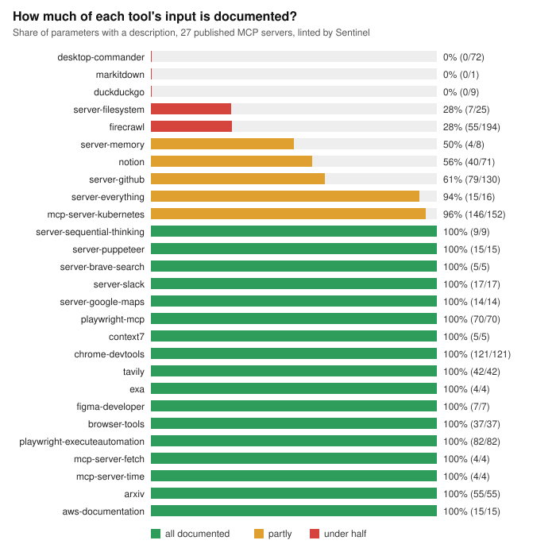

# Benchmarks

Two measurements against servers this project did not write. Both are reproducible; each prints
a table and writes it next to the script.

| | Script | Result file |
|---|---|---|
| Does Sentinel catch violations that the MCP maintainers labelled? | `official_negatives.py` | [`RESULTS.md`](RESULTS.md) |
| What does Sentinel report on servers built with the official SDKs? | `sdk_readiness.py` | [`SDK_RESULTS.md`](SDK_RESULTS.md) |
| How do 28 widely used published servers fare? | `popular_servers.py` | [`POPULAR_SERVERS.md`](POPULAR_SERVERS.md) |

```bash
git clone https://github.com/modelcontextprotocol/conformance && cd conformance
npm ci && (cd examples/servers/typescript && npm ci) && cd -
uv run python benchmarks/official_negatives.py --conformance ../conformance
uv run python benchmarks/sdk_readiness.py      --conformance ../conformance
```

Measured against `modelcontextprotocol/conformance` at commit `c37eec8`, run on 2026-10-22; the SDK numbers are for `mcp` 2.3.0 from PyPI.

## How to read the numbers

**Answer key.** The broken servers in `modelcontextprotocol/conformance` each carry a header
comment naming their one violation. Those labels were written by the MCP maintainers for their
own test suite. Each label is mapped to the Sentinel rule that should catch it (the `LABELS` table at the top of
the script, taken from the fixtures' own comments), and a rule counts as caught only if it FAILed.
Be aware that this is not a blind test: the rules existed before these fixtures were run, but the
same person looked at the fixtures while writing the mapping, and no rule was changed to improve
these results. One change *was* made from the SDK scan: the stub-description threshold went from
20 to 12 characters after "Add two numbers." was flagged, which is a false positive.

**Misses and exclusions are reported, not tuned away.** The seven broken servers carry eight
rule-level violations in total (one server names a violation Sentinel has no rule for):

- 7 of 8 are caught. Six on servers that speak the current protocol, one on a server that has not
  migrated (for the rules that only read the tool manifest, Sentinel opens a previous-revision
  session instead of reporting "unreachable");
- the remaining one, `no-dns-rebinding-protection`, is *not gradable*: with the installed SDK it
  answers every request, for any client, with HTTP 500 ("inputSchema must be a Zod schema"), so
  Sentinel correctly reports INDETERMINATE rather than guess. It stays in the table but out of the
  denominator;
- `sep-2106-stripped-schema` (JSON Schema 2020-12 keywords stripped) has no Sentinel rule and
  contributes no expectation. That is a coverage gap, not a catch.

Net: **7 of the 7 gradable violations caught**, 1 fixture unusable, 1 known coverage gap.

## Head to head with the official suite, on a server it was not built for

Same server, the official Python SDK demo (two tools, no special fixtures), graded by each tool:

| | Official `conformance` suite (`--requirements 2026-07-28`) | Sentinel |
|---|---|---|
| What it needs from the server | its own fixed test tools, prompts and resources | nothing |
| Result on this server | 113 checks pass, 57 fail | 26 required rules pass, 3 fail |
| Why the failures | in the scenarios I sampled (`tools-call-image`, `prompts-get-simple`) the server simply lacks the suite's fixtures: "No image content found", "Unknown prompt: test_simple_prompt". Those are not violations by the server | the 3 fails are real divergences from the spec text (error codes); the rest is checked on whatever the server exposes |
| Flags the undocumented tool | yes ("Tool 1: missing description") | yes |
| Flags the wrong rejection error code | no (it treats the code as optional) | yes (the spec text says MUST) |

So the two answer different questions. The official suite checks content handling (images, prompts,
resources, tasks, OAuth flows) on servers built to its fixtures, and Sentinel does not cover those.
Sentinel grades an arbitrary server as it is, and adds checks the suite lacks (description quality,
tool-text injection, Origin, header rules). Use both.

## The whole registry

[`REGISTRY_SCAN.md`](REGISTRY_SCAN.md): every remote server in the official MCP registry (15,451
endpoints) classified, plus a 4,000-endpoint sample graded with corrected rules, from the
`registry-scan` workflow. 14.6% speak the new revision, 35.7% only the previous one, 39.1% need
credentials; 16% of the new-revision servers in the sample pass every verifiable required rule. Aggregate
only, never per server.
The workflow runs on GitHub's runners because the environment these benchmarks were developed in
cannot reach the public internet. The first full run overstated failures (an allowed behaviour and rate-limit answers were read as
findings); the page records how that was found and fixed.

## Published servers: the larger sample

> **How this number was corrected.** The first version of the parameter rule counted only a
> `description` on the schema property, and reported 10 of 27 servers with 28% of parameters
> undocumented. Reading the source of the first server I meant to report (`duckduckgo-mcp-server`)
> showed all nine parameters documented in a docstring `Args:` block that the SDK puts in the tool
> description but not the schema. The official filesystem server's `path` parameters were flagged
> although their name says what they are. Both were false positives in the rule, so it now accepts
> prose documentation, nested object descriptions and self-evident plain-string names. The
> corrected result is 8 of 28 servers and 17% of parameters. The rule is stricter than a model
> needs in one respect (it prefers schema descriptions) and says so in its remediation.





`popular_servers.py` starts 29 published servers the way their READMEs say (`npx -y ...` or `uvx ...`,
with dummy credentials where a token is only needed to start), reads each tool list over stdio, and
runs Sentinel's manifest rules. 28 started. Result: **362 tools and 1,349 parameters; 8 of 28 servers
have parameters documented nowhere (234 parameters, 17%); 3 more document some only in the
description text.** The one that did not start is listed.

Limits: the list is hand-picked to span reference, vendor and community servers, not the top N by
stars (no registry API is reachable from here). Only top-level parameters are counted. The
credential-path check flagged `.env`/`.aws` mentions in two servers' descriptions; those read as
warnings, not attacks, so they are reported separately and not counted as injection. Per-server
results are in the table so any of them can be rechecked.

## Speed: one server process, not one per rule

`sentinel lint` first started the server once per rule (a dozen times). The lint rules only read, so
they now share one process. Same rule outcomes, wall-clock for a full lint on this machine:

| Server | One process per rule | One shared process |
|---|---|---|
| `server-filesystem` | 6.8 s | 1.0 s |
| `@playwright/mcp` | 6.1 s | 1.2 s |
| `server-github` | 4.7 s | 0.9 s |
| `notion-mcp-server` | 5.0 s | 1.1 s |

Single runs after the packages were already cached, so treat the ratio (4.4x to 6.7x) as the point,
not the decimals.

## Other tools

I tried [Snyk Agent Scan](https://appsecsanta.com/mcp-scan) (formerly Invariant's `mcp-scan`) on the
same kind of server. Its security analysis calls Snyk's cloud service, which this environment cannot
reach, so `scan` hung until killed and I have **no comparison to report**. It does not check protocol
conformance either; the overlap with Sentinel is the tool-description security check, and that
comparison needs a machine with internet access and a Snyk token.

## Where Sentinel is stricter than the official suite, on purpose

- **Error codes for rejected headers.** The specification text says a server rejecting a request for a
  bad or missing standard header MUST answer HTTP 400 *and* JSON-RPC code `-32020`. The official suite
  treats the code as a SHOULD for standard headers. Sentinel follows the spec text, so a server
  that answers 400 with some other code (the Python SDK answers `-32600`) FAILs here and passes there.
  Both readings are written down; neither is hidden.
- **Origin validation and the `Mcp-Method` / `Mcp-Name` headers.** The spec says MUST. The official
  suite's own header scenarios are still marked *pending*, and its reference server does not enforce
  them either.

## Limits

- Public servers on the internet were not scanned: the environment these were produced in blocks
  outbound connections to them. The broken fixtures and SDK servers run on localhost.
- Eight labelled violations is a small sample. The result is "it catches what it was built to catch
  and says where it cannot", not a precision/recall figure to quote to three digits.
